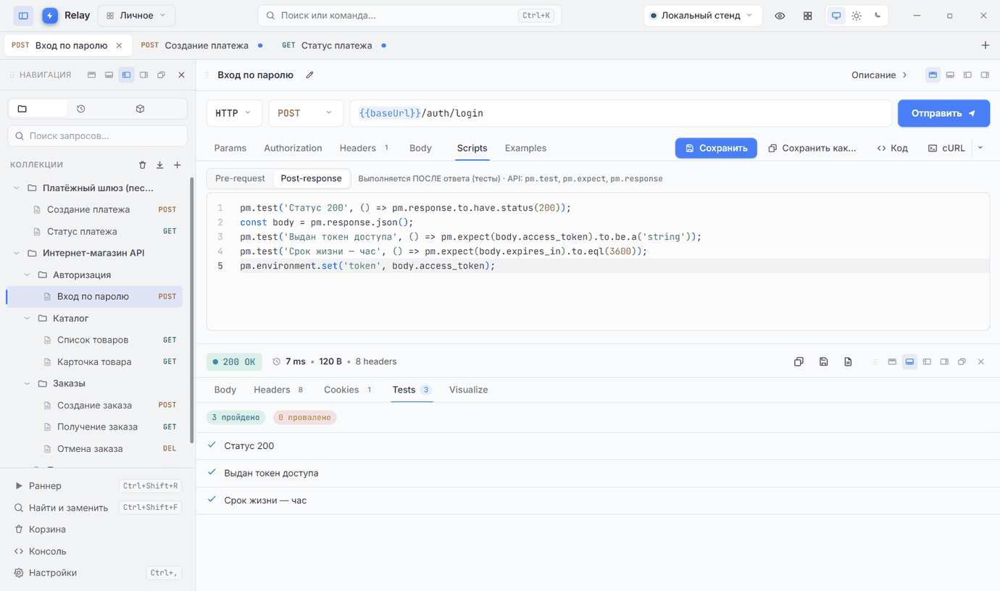
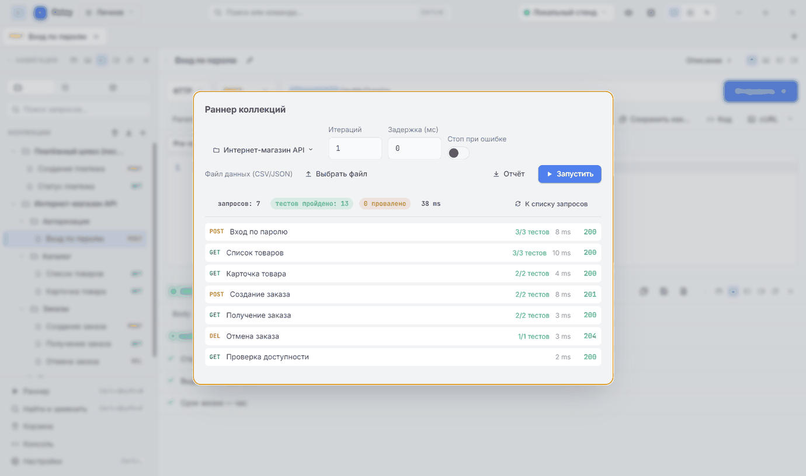
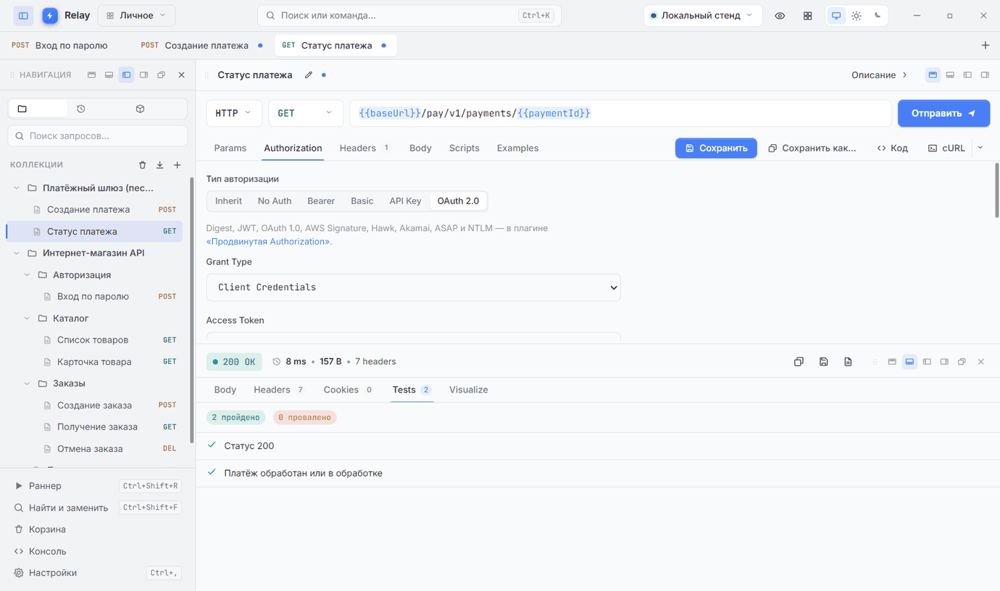

# Relay from scratch: download, build, run and try it out

*[Русская версия](README.ru.md)*

This guide is for people who have never built a program from source code. You do not need to know
anything in advance: every step is spelled out, and the technical work is done by the ready-made
scripts in this folder — you only run them in order with a double-click.

**Relay** is a desktop application for testing APIs: it sends requests to web services and shows
their responses. Besides the scripts, this folder holds a demo "online shop" service and ready-made
requests for it, so you can check right away that everything works.

| What you need | |
|---|---|
| Computer | Windows 10 or 11, macOS 11 or newer, Linux (Ubuntu 22.04+, Debian 12+, Fedora 38+ and similar) |
| Internet | about 750 MB, downloaded once |
| Disk space | about 2 GB |
| Time | 15–30 minutes, mostly waiting for downloads |

## Contents

- [Don't want to build? Download the app](#dont-want-to-build-download-the-app)
- [A few words you will meet below](#a-few-words-you-will-meet-below)
- [Step 1. Install Node.js](#step-1-install-nodejs)
- [Step 2. Download Relay from GitHub](#step-2-download-relay-from-github)
- [Step 3. Install the components](#step-3-install-the-components)
- [Step 4. Start Relay](#step-4-start-relay)
- [Step 5. Try the examples](#step-5-try-the-examples)
- [Step 6. Automated tests (optional)](#step-6-automated-tests-optional)
- [Step 7. Build an installer (optional)](#step-7-build-an-installer-optional)
- [If something goes wrong](#if-something-goes-wrong)
- [Updating and removing](#updating-and-removing)
- [For terminal users](#for-terminal-users)
- [What is in this folder](#what-is-in-this-folder)

---

## Don't want to build? Download the app

Ready-made installers of the latest version are on [Google Drive][gdrive]. Pick the file for your
system:

| System | File | How to install |
|---|---|---|
| Windows (a regular PC) | `Relay-<version>-Setup.exe` | Run it and follow the installer |
| Windows on an ARM processor | `Relay-<version>-arm64-Setup.exe` | The same |
| Linux (a regular PC) | `relay-api-client-<version>.tar.gz` | Unpack and run — see [step 7](#first-launch-of-an-unsigned-app) |
| Linux on an ARM processor | `relay-api-client-<version>-arm64.tar.gz` | The same |
| macOS | `Relay-<version>-arm64.dmg` (Apple M1–M4), `Relay-<version>-x64.dmg` (Intel) | Open it, drag Relay into Applications. If there are no macOS files on the drive, build them on a Mac with [step 7](#step-7-build-an-installer-optional) |

The app is not signed with a paid developer certificate, so on the first launch your system warns
about an unknown publisher — what to click is in
[step 7](#first-launch-of-an-unsigned-app).

To try the examples later (step 5) you still need Node.js (step 1) and the folder with the examples
(step 2): the demo service runs on Node.js.

---

## A few words you will meet below

| Word | What it is |
|---|---|
| **GitHub** | A website that stores the source code of programs. Relay's code is at github.com/CHUKEPC/Relay |
| **Source code** | The text of a program, from which the runnable app is built. It can be downloaded as one archive |
| **Node.js** | A free program needed to build and run Relay from its source code |
| **npm** | Comes with Node.js and downloads the components Relay is made of |
| **Terminal** | A window where you type commands. The scripts in this folder open one by themselves |
| **Build** | Turning the source code into a working app. The scripts do it for you |
| **Installer** | One file (`.exe`, `.dmg`, `.AppImage`) that installs the app on any computer |
| **API, request, response** | Programs talk over the network: one sends a request, the other sends back a response. Relay shows both |
| **Server, port, 127.0.0.1** | A server is a program that answers requests. `127.0.0.1` means "this very computer", and a port is the number of a "door" — the demo service uses 8470 and 8471 |

### How to open a terminal

The scripts in this folder do not need a terminal — they open a window themselves. A terminal is
handy to check the Node.js version or to run a command from "If something goes wrong".

- **Windows:** press `Win + R`, type `cmd` and press Enter. Or: Start → start typing "Terminal" →
  open it.
- **macOS:** press `Cmd + Space`, type "Terminal" and press Enter.
- **Linux:** press `Ctrl + Alt + T` or find "Terminal" in the app menu.

---

## Step 1. Install Node.js

You need version **20 or newer**. The website marks it **LTS** — "long-term support", the most
stable version.

**Windows**

1. Open https://nodejs.org and click the big button labelled **LTS**.
2. Run the downloaded `node-v…-x64.msi` and click "Next" until you see "Finish". The
   "Automatically install the necessary tools" box does not need to be ticked.

If you forget Node.js, the very first script in step 3 says so and offers to install it for you
(through winget, the installer built into Windows) or opens the website.

**macOS**

1. Open https://nodejs.org, click **LTS** and download the **macOS Installer (.pkg)**.
2. Open the `.pkg` file and go through the installer ("Continue" → "Install"; it asks for your
   computer password).

**Linux**

Packages from the standard software store are often too old, so install Node.js with nvm — the way
nodejs.org itself recommends. Open a terminal and run, one at a time:

```bash
curl -o- https://raw.githubusercontent.com/nvm-sh/nvm/v0.40.1/install.sh | bash
```

Close the terminal, open a new one and run:

```bash
nvm install --lts
```

If `curl` is not found, first run `sudo apt install curl` (Ubuntu, Debian) or `sudo dnf install curl`
(Fedora).

**Check.** Open a **new** terminal and run:

```bash
node -v
```

You should see something like `v22.11.0`. Is the first number 20 or more? Then you are set.

---

## Step 2. Download Relay from GitHub

### Option A — as an archive (easiest)

1. Open https://github.com/CHUKEPC/Relay.
2. Click the green **"Code"** button, then **"Download ZIP"** in the menu.
3. Unpack the archive:
   - **Windows:** right-click `Relay-main.zip` → "Extract All…" → "Extract";
   - **macOS:** double-click the archive;
   - **Linux:** right-click → "Extract Here" (or `unzip Relay-main.zip` in a terminal).

You get a `Relay-main` folder. It is best placed where the path has no spaces or non-Latin letters,
for example `C:\Relay-main` on Windows or your Documents folder on macOS and Linux.

### Option B — with Git (easy to update)

Git is a program that downloads code from GitHub and later fetches updates with one command.

- **Windows:** download the installer from https://git-scm.com and click "Next" to the end.
- **macOS:** run `git --version` in a terminal — if Git is missing, macOS offers to install the
  "command line developer tools"; accept.
- **Linux:** `sudo apt install git` (Ubuntu, Debian) or `sudo dnf install git` (Fedora).

Then, in a terminal, go to the folder where you want Relay and run:

```bash
git clone https://github.com/CHUKEPC/Relay.git
```

You get a `Relay` folder.

> From here on the project folder (`Relay-main` or `Relay`) is simply called **the Relay folder**.
> This guide and the scripts are inside it, in the `getting-started` folder.

---

## Step 3. Install the components

Open the Relay folder → `getting-started` → the folder of your system: `windows`, `macos` or
`linux`. The scripts in it are numbered — run them in order.

**Windows.** Double-click `1-install.cmd`. If Windows asks "The publisher could not be verified…"
or shows a blue "Windows protected your PC" window, click "Run" (or "More info" → "Run anyway"):
the script came from the internet, and Windows warns about every such file.

**macOS.** The first time, **right-click** `1-install.command` → "Open" → "Open". A plain
double-click is blocked by macOS because the file came from the internet; after the first time it
works too. Open the other scripts the same way the first time.

**Linux.** Open a terminal in the Relay folder (right-click an empty spot in the folder →
"Open in Terminal") and run:

```bash
bash getting-started/linux/1-install.sh
```

A window with text opens. The script checks Node.js and downloads the components — about 750 MB,
usually 2–10 minutes. Lines with `WARN` during the download are normal. Wait for:

```
✔ Done! The components are installed.
```

If an error shows up instead, see [If something goes wrong](#if-something-goes-wrong). When the main
download server is unreachable, the script offers to retry through a mirror by itself.

---

## Step 4. Start Relay

Run `2-start-relay` (Windows: `2-start-relay.cmd`, macOS: `2-start-relay.command`,
Linux: `bash getting-started/linux/2-start-relay.sh`).

The first time, the script builds the app (1–2 minutes) and then opens its window. Later starts take
a few seconds: it rebuilds only when the source code has changed. Once you see
`✔ Relay is running in its own window.`, you can close the script window — Relay keeps running.

**First look.** On the first start Relay offers a short tour of the interface — take it or click
"Пропустить" (Skip).

**Language.** Relay opens in Russian. To switch to English: «Настройки» (Settings, at the bottom of
the sidebar, or `Ctrl + ,`, on macOS `Cmd + ,`) → «Основные» (General) → «Язык интерфейса»
(Interface language) → English. The steps below use the English names.

---

## Step 5. Try the examples

The examples talk to a demo "online shop" that runs right on your computer: nothing goes out to the
internet, and the answers are always the same.

### 5.1. Start the demo service

Run `3-demo-server`. Two windows open:

- **the examples folder** `getting-started/demo` — you need it in the next step;
- **the service window** — it lists every request that arrives. **Keep it open** while you try the
  examples: closing it stops the service.

The service runs two "stands", as if they were two different servers:

| Stand | Address |
|---|---|
| Локальный стенд (local stand) | http://127.0.0.1:8470 |
| Тестовый стенд (test stand) | http://127.0.0.1:8471 |

### 5.2. Load the examples into Relay

In the examples folder select four files (click them while holding `Ctrl`, on macOS `Cmd`):

- `shop-api.postman_collection.json` — the "Интернет-магазин API" (online shop API) collection:
  7 requests, 13 checks;
- `payment-gateway.postman_collection.json` — "Платёжный шлюз (песочница)" (payment gateway
  sandbox): 2 requests with OAuth 2.0;
- `local-stand.postman_environment.json` and `test-stand.postman_environment.json` — the
  "Локальный стенд" and "Тестовый стенд" environments.

Drag them with the mouse into the Relay window. Both collections appear on the left, under
Collections.

**Pick the environment.** At the top of the Relay window, right of the search box, click "No
environment" and choose **"Локальный стенд"**. An environment is a set of variables: for example,
`{{baseUrl}}` in the request addresses becomes `http://127.0.0.1:8470`.

The example requests are named in Russian; the names are given below with a translation.

### 5.3. Check step by step

A request opens with a click in the sidebar and is sent with **Send** (or `Ctrl + Enter`, on macOS
`Cmd + Enter`). The response appears in the lower part of the window.

1. **Health check.** Open "Интернет-магазин API" → "Проверка доступности" (health check) → Send.
   Response: `200 OK` and the stand's name. Switch the environment to "Тестовый стенд" and send
   again — the second stand answers. Switch back to "Локальный стенд".

2. **Sign-in with a password.** "Авторизация" (authorization) → "Вход по паролю" (password sign-in)
   → Send. Open the **Tests** tab of the response: 3 checks passed. The script on the Scripts →
   Post-response tab saved the token it got into the `token` variable — the other requests of the
   collection use it on their own.

   

3. **Catalog.** "Каталог" (catalog) → "Список товаров" (product list) → Send: a list of 5 products.
   Hover over `{{baseUrl}}` in the address — Relay shows the variable's value and where it comes
   from.

4. **An order chain.** "Заказы" (orders) → "Создание заказа" (create order) → `201 Created`; the order
   number is kept in the `orderId` variable. Then "Получение заказа" (get order, `200`) and
   "Отмена заказа" (cancel order, `204`) — they work with that very order.

5. **The runner: all requests at once.** Right-click the "Интернет-магазин API" collection →
   Run → Run. Expected result: **7 requests, 13 tests passed, 0 failed**. The Report button saves
   the result to a file.

   

6. **A data file.** Right-click the "Каталог" folder → Run → "Choose a file" → `catalog-data.csv`
   from the examples folder → Run: 5 iterations, one per product 101–105, all checks pass. With
   `catalog-data-negative.csv` the iteration with the non-existent product 999 gets `404`, and the
   runner shows which checks failed — that is intended.

7. **OAuth 2.0.** "Платёжный шлюз (песочница)" → "Создание платежа" (create payment) → the
   **Authorization** tab → "Get a token" → Send: `201`. Then "Статус платежа" (payment status):
   "Get a token" → Send → `200`, 2 checks passed.

   

8. **The real internet.** Open a new tab (`Ctrl + N`, on macOS `Cmd + N`), paste
   `https://httpbin.org/get` into the address bar and click Send. A `200` response with details about
   the request means Relay reaches the outside network too.

### 5.4. A few more things to try

- **Tab groups.** Right-click the "Заказы" folder → "Open the requests as a tab group". A click on the
  coloured label folds and unfolds the group; a right-click gives its name, colour and actions. Drop a
  tab on the label or on the group's tabs and it joins the group; drop it in the gap between two
  groups and it joins neither.
- **Trash.** Delete any request (right-click → Delete) and click Restore in the pop-up message, or open
  Trash at the bottom of the sidebar. How many days deleted items are kept is set in Settings → Data.
- **Variable hints.** In the body of "Создание заказа" type `{{` — a list of variables appears; `{{$`
  lists dynamic variables such as `{{$guid}}` and `{{$randomInt}}`.
- **Beautify.** Paste `{"productId":{{productId}},"quantity":1}` into the body and click Beautify —
  the JSON is laid out even with unquoted variables.
- **Code.** The Code button shows the same request as cURL and in a dozen more languages.

### Demo service sign-ins

| What | Value |
|---|---|
| Shop login and password | `tester` / `secret` |
| OAuth 2.0 client (payment gateway) | `relay-desktop` / `demo-secret` |

They are already in the environments; there is nothing to type. The service keeps its data in
memory: after a restart, orders are numbered from 5001 (local stand) and 7001 (test stand) again.

---

## Step 6. Automated tests (optional)

Run `4-run-tests`. For about a minute the app checks itself — nearly a thousand tests. At the end
you see a summary like this (the numbers may differ slightly):

```
 Test Files  79 passed (79)
      Tests  968 passed | 9 skipped (977)
✔ All tests passed.
```

`passed` means the test passed. `skipped` are tests that go to outside websites; they are switched
off so the result does not depend on the internet. The summary must not contain `failed`.

---

## Step 7. Build an installer (optional)

An installer is a single file you can take to another computer and install Relay like any app,
without Node.js and without this folder. Run `5-build-installer` and wait 2–5 minutes. The file
appears in the `release` folder inside the Relay folder; the script prints its path:

| System | File in `release` |
|---|---|
| Windows | `Relay-<version>-Setup.exe` |
| macOS | `Relay-<version>-arm64.dmg` (Apple M1–M4) or `Relay-<version>-x64.dmg` (Intel) |
| Linux | `Relay-<version>.AppImage` |

The installer is built for the system the script runs on: the macOS file is made on a Mac, the
Linux one on Linux.

### First launch of an unsigned app

Relay has no paid developer certificate, so systems warn about an unknown publisher.

- **Windows:** in the "Windows protected your PC" window click "More info" → "Run anyway".
- **macOS:** open the `.dmg` and drag Relay into Applications. The first time, start it with a
  right-click → "Open" → "Open". If macOS says the app "is damaged" or "can't be opened", open
  System Settings → Privacy & Security and click "Open Anyway" at the bottom of the page.
- **Linux (AppImage):** make the file executable — right-click → Properties → Permissions → "Allow
  executing file as program", or in a terminal:

  ```bash
  chmod +x Relay-*.AppImage
  ./Relay-*.AppImage
  ```

  If the AppImage does not start and mentions `libfuse`, install `sudo apt install libfuse2`
  (on Ubuntu 24.04: `sudo apt install libfuse2t64`). The `.deb` package installs with
  `sudo apt install ./relay_<version>_amd64.deb`.
- **Linux (`tar.gz` archive):** unpack it and start it in a terminal:

  ```bash
  tar -xzf relay-api-client-*.tar.gz
  cd relay-api-client-*/
  ./relay-api-client
  ```

  If it does not start and mentions `chrome-sandbox` or `sandbox`, start it with
  `./relay-api-client --no-sandbox`.

---

## If something goes wrong

First run the check — it shows what is installed and what is missing. In a terminal, in the Relay
folder:

```bash
node getting-started/scripts/helper.mjs doctor
```

| What you see | What to do |
|---|---|
| `'node' is not recognized as an internal or external command` / `node: command not found` | Node.js is not installed, or the terminal was opened before installing it. Do step 1 and open a new window |
| `Node.js 18… is installed, but 20 or newer is needed` | The version is old. Install the LTS from nodejs.org (step 1) |
| A macOS script does not open with a double-click | Right-click → "Open" → "Open". If it says "permission denied", run in a terminal in the Relay folder: `chmod +x getting-started/macos/*.command` |
| `Downloading the components failed`, `ETIMEDOUT`, `ECONNRESET` | No internet, or a proxy, VPN or antivirus is in the way. Accept the retry through the mirror, or run `1-install` again |
| `EPERM`, `operation not permitted` (Windows) | An antivirus or a running Relay holds the files. Close Relay and run `1-install` again |
| On Linux the Relay window does not open and the log says `error while loading shared libraries` | System libraries are missing: `sudo apt install libgtk-3-0 libnss3 libgbm1 libasound2` (on Ubuntu 24.04 use `libasound2t64` instead of `libasound2`) |
| Requests answer `ECONNREFUSED` | The demo service is not running or its window was closed. Run `3-demo-server` again |
| `Не удалось запустить «Локальный стенд» на порту 8470` (could not start on port 8470) | Another program uses the port (if the service itself is already running, the script says so and does not start a second one): start the service on other ports (`node getting-started/demo/demo-server.mjs 9470 9471`) and change `baseUrl` in the environments |
| `401 unauthorized` | Send "Вход по паролю" first and check that the "Локальный стенд" environment is selected at the top |
| `release\win-unpacked is in use` while building the installer | Close the Relay started from this folder and run `5-build-installer` again |

`2-start-relay` writes the log of the last start to the system's temporary folder, in
`relay-start.log`, and prints its path when something goes wrong.

---

## Updating and removing

**Update.** Download the archive again (option A) or run `git pull` in the Relay folder (option B).
Then run `1-install` (it fetches whatever components changed) and `2-start-relay` — the build
refreshes by itself.

**Remove.** Delete the Relay folder. The app's data — collections, environments, history — is kept
separately, in your user folder:

| System | Data folder |
|---|---|
| Windows | `%APPDATA%\Relay` |
| macOS | `~/Library/Application Support/Relay` |
| Linux | `~/.config/Relay` |

You can delete it too if you no longer need the data. Relay built from source and Relay from the
installer share this data folder.

---

## For terminal users

The scripts wrap ordinary commands, run in the Relay folder:

```bash
npm ci                                # components (same as 1-install)
npx electron-vite build               # build into out/
npx electron .                        # start the built app
npm run dev                           # development mode with hot reload
node getting-started/demo/demo-server.mjs   # the demo service
npm test                              # automated tests (Vitest)
npm run build:win                     # Windows installer; also build:mac and build:linux
```

---

## What is in this folder

| Path | Purpose |
|---|---|
| `windows/1-install.cmd` … `5-build-installer.cmd` | Scripts for Windows: run with a double-click |
| `macos/1-install.command` … `5-build-installer.command` | The same for macOS |
| `linux/1-install.sh` … `5-build-installer.sh` | The same for Linux: `bash getting-started/linux/<script>` |
| `scripts/helper.mjs` | The logic behind all scripts: install, build, start, tests, diagnostics |
| `scripts/check-node.cmd`, `scripts/check-node.sh` | Check that Node.js is installed and say how to get it |
| `demo/demo-server.mjs` | The demo "online shop" service (needs only Node.js) |
| `demo/*.postman_collection.json` | Request collections: online shop API, payment gateway sandbox |
| `demo/*.postman_environment.json` | The "Локальный стенд" and "Тестовый стенд" environments |
| `demo/catalog-data.csv`, `demo/catalog-data-negative.csv` | Data files for the runner |
| `images/` | Pictures for this guide |

The scripts print their messages in the system language — Russian or English. Set the
`RELAY_LANG=en` or `RELAY_LANG=ru` environment variable to choose.

[gdrive]: https://drive.google.com/drive/folders/1p9DhgqohWKuRfj-_BfzINBKZbihDD0Zu?usp=sharing
